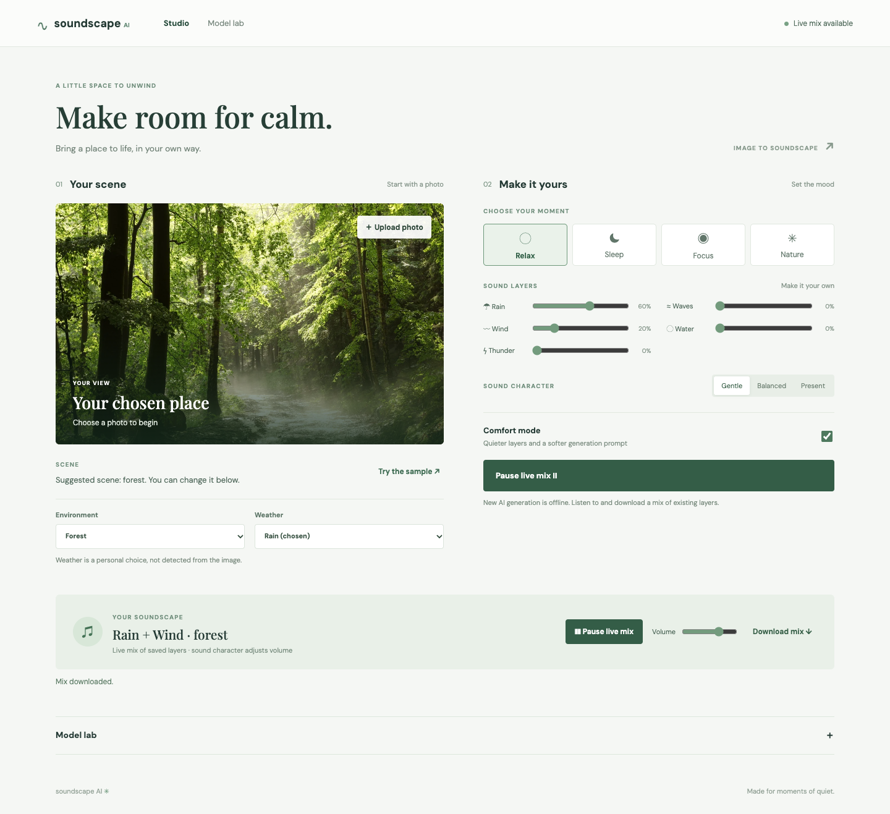
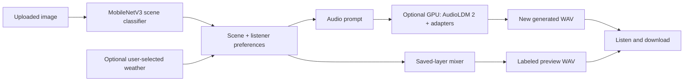

# SoundScape AI

**A vision-guided studio for personalized, ASMR-inspired nature soundscapes.**

Upload a scene, shape its atmosphere, and listen to a soundscape made for your moment. SoundScape is an experimental multimodal system combining computer vision, text-to-audio diffusion and audio processing; it is not a single vision-language model or a medical treatment.

[Open the live studio](https://soundscape-ai-studio.onrender.com) · [Research and listening protocol](docs/research/relaxation_soundscape_research.md) · [V2 experiment report](SoundScape_V2_Report.md)



*Screenshot captured from the locally running application with the sample image and saved-layer preview. [Mobile view](docs/images/studio-mobile.png).*

## Create a soundscape

1. Upload a nature photo or use the sample. The trained scene model suggests a scene; you can correct it.
2. Choose Relax, Sleep, Focus or Nature, then adjust the rain, waves, wind, water and thunder layers. Weather is a user choice; the current model does not recognize weather.
3. Play the saved-layer mix and adjust its sliders while listening. Download a 30-second WAV of the current mix. When a GPU service is configured, the creation button requests a new recording; it is distinct from the saved-layer mix.

Comfort mode reduces preview gain and adds softer language to a new-generation prompt. Sound character adjusts preview volume rather than generating a different recording. Their perceptual effects have not been validated. Presets express listening preferences; they are not clinical claims. The Model Lab contains previously generated original and LoRA comparisons.

## Architecture



The public Render web service runs CPU scene inference and serves saved WAVs. An optional separately hosted GPU service can receive a prompt; configuration alone does not establish that it is live. The prompt includes all selected sounds, but model adherence is unverified. Layer sliders control the live saved-layer mix; selecting rain or wind adds that sound, while snow and fog are visual preferences. The image model does not infer weather or prove that a sound is present.

## Evidence and model status

Athir's [original notebook](notebooks/SoundScape_AI_Project_original.ipynb) is preserved byte-for-byte, including its 93 cells, comments, saved outputs and Intensity/Comfort LoRA experiments. The [V2 notebook](notebooks/SoundScape_AI_Project_V2.ipynb) appends matched-seed comparisons, train-only proxy thresholds, an optional diagnostic adapter experiment and distinct-segment long-form workflow. These additions have not been executed on a GPU.

The original experiment used 200 ESC-50 recordings in five classes with source-disjoint folds. It records two 150-step LoRA runs; lower denoising loss does not establish listening quality. For a one-seed intensity proxy, both baseline and adapter matched the expected direction in 4/5 classes. Comfort labels were inferred from acoustic proxies, not human judgments. No production model is selected as perceptually superior.

The five [saved 60-second WAV layers](assets/audio/) repeat shorter generated material. Six [original versus LoRA examples](assets/audio/comparisons/) are from the teammate's executed notebook. The [measurement report](docs/results/saved_audio_metrics.csv) contains integrated LUFS and four-times-oversampled peak estimates for these real files; measurements do not establish relaxation, realism, or certified true peak. No V2 listening ratings or fresh generation results are claimed.

## Run locally

```bash
python -m pip install -r requirements-cloud.txt
python -m uvicorn app.main:app --host 127.0.0.1 --port 8000
```

Open [localhost:8000](http://127.0.0.1:8000). The app requires FastAPI and cannot be opened as a standalone HTML file. For a CUDA environment and the separately exported LoRA weights, see [RUN_GPU.md](RUN_GPU.md) and [CONNECT_CV_AND_GPU.md](CONNECT_CV_AND_GPU.md). Never commit credentials or model weights. Optional measurements require `pip install pyloudnorm` and `python scripts/evaluate_saved_audio.py`.

```bash
python -m pip install pytest httpx
python -m pytest -q tests/test_audio_quality.py tests/test_audio_playback.py tests/test_app.py tests/test_cloud_vision.py tests/test_remote_gpu.py
node --check frontend/app.js
```

## Research, rights and limitations

- [Research review and testable design implications](docs/research/relaxation_soundscape_research.md); [listening rating template](listening_ratings_template.csv).
- [AudioLDM 2](https://huggingface.co/cvssp/audioldm2) weights are CC BY-NC-SA 4.0. [ESC-50](https://github.com/karolpiczak/ESC-50) is generally noncommercial; review individual attribution and licenses before use or redistribution.
- Stable Audio Open is an unverified candidate with its own access and license terms. The optional comparison has not been run. See [GPU options](docs/architecture/gpu-options.md) for current cost and quota considerations.
- The scene model has six scene classes and no validated weather head. The LoRA checkpoint is not embedded in the notebook. GPU availability, live inference, cross-model quality and long-duration listening require further testing.
- Athir authored the preserved original audio notebook and LoRA experiments; SoundScape AI contributors built the vision, integration and V2 evaluation work. See [AUDIO_NOTEBOOK_FINDINGS.md](AUDIO_NOTEBOOK_FINDINGS.md) for attribution and results.
